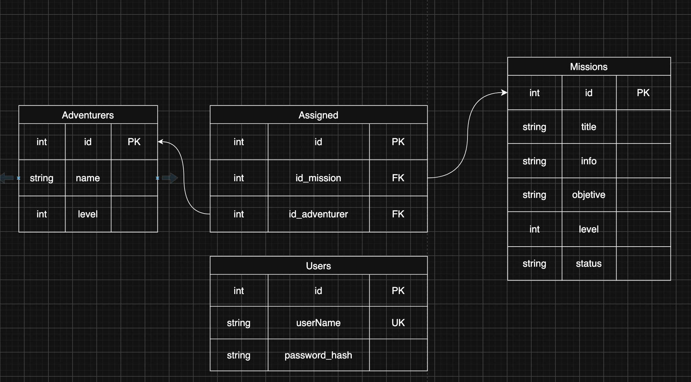

# Diagrama Entidad-Relación · Gremio de Aventureros

Este es el DER de la base de datos PostgreSQL (base `gremio`) que usa la API. Cada entidad es una tabla. La tabla `users` existe para el registro, el login y los roles (`admin` / `user`).

## Cómo leerlo

**Relaciones**

| Relación | Cardinalidad | En palabras | Tabla intermedia |
|---|---|---|---|
| missions → assignments | 1 a N | Una misión puede tener muchas asignaciones. Una asignación es de una sola misión. | `assignments.id_mision` |
| adventurers → assignments | 1 a N | Un aventurero puede estar asignado a muchas misiones. Una asignación es de un solo aventurero. | `assignments.id_adventurers` |

En conjunto, `missions` y `adventurers` tienen una relación **N a M**: una misión puede tener varios aventureros y un aventurero puede tomar varias misiones. `assignments` es la tabla que resuelve esa relación.

**Claves**

- `PK` es la clave primaria. En todas las tablas es `id`, entero autoincremental.
- `FK` es una clave foránea: una columna que guarda el `id` de una fila de otra tabla. `assignments.id_mision` apunta a `missions.id`, y `assignments.id_adventurers` apunta a `adventurers.id`.
- `UK` es una clave única. `users.username` no puede repetirse.

**Restricciones adicionales**

- `assignments` tiene un índice único sobre `(id_mision, id_adventurers)`. Así un mismo aventurero no puede anotarse dos veces en la misma misión.
- Las columnas `level` y `level_adventurer` tienen un `CHECK (level >= 1)`.
- Al borrar una misión o un aventurero, sus asignaciones se borran en cascada (`ON DELETE CASCADE`).

## Decisiones de diseño para discutir

**`status_mision` es manual, no derivado.** Podría calcularse a partir de las asignaciones, pero no lo hacemos porque el estado de una misión (por ejemplo `cancelled`) depende de decisiones del gremio que no se deducen de los datos. La API lo cambia con `PATCH /missions/{id}`.

**Se eliminó `id_adventurers` de `MISSIONS` y `id_mision` de `ADVENTURERS`.** El diagrama original tenía esas columnas, pero como la relación es N a M, guardarlas en las entidades duplicaría la información que ya tiene `assignments`. Además, crearían un ciclo entre tablas.

**Se agregó `USERS`.** La consigna pide registro, login y roles, y no tiene sentido guardar eso en las otras tablas.